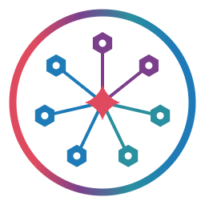
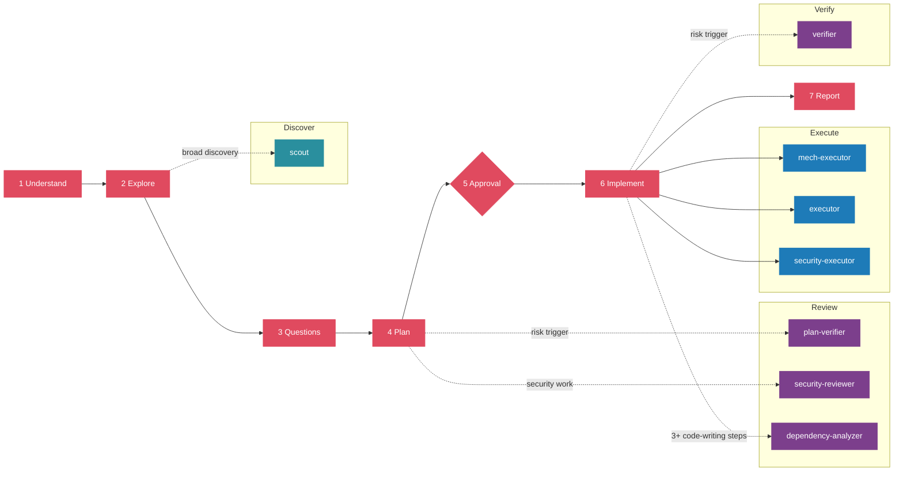
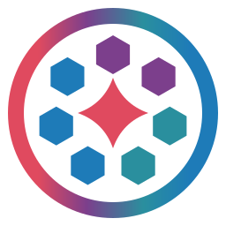

<div align="center">



<h1>Conclave</h1>

<p><b>Plan-first orchestration for Claude Code</b></p>

<p>


<a href="LICENSE"></a>
</p>

<p>
<a href="#how-it-works">How it works</a> ·
<a href="#what-ships">What ships</a> ·
<a href="#requirements">Requirements</a> ·
<a href="#install">Install</a> ·
<a href="#use">Use</a> ·
<a href="#develop">Develop</a>
</p>

</div>

conclave is a Claude Code plugin that packages a plan-first way of working with subagents. The main session plans, briefs, integrates and verifies; narrowly scoped role agents do the discovery, the implementation and the independent review. The repository is both the plugin and its marketplace (`conclave-agent-fleet`).

## How it works

Each skill is run by the main session, which dispatches role agents for the work it does not do itself; the Skills table under [What ships](#what-ships) lists which agents each skill uses. The fullest path is `/conclave:implement`: seven phases, an approval gate, and agents called only where `skills/implement/SKILL.md` and `guidance/CLAUDE-ORCHESTRATION.md` call for them. Dashed edges are conditional.



## What ships

### Agents

Dispatched as `conclave:<name>`.

| Agent | Model | Role |
|---|---|---|
| `scout` | haiku | Read-only reconnaissance; locates files, symbols and usages and reports with file:line references. |
| `researcher` | sonnet | Read-only external research on the web, GitHub, library docs and the Obsidian vault; returns an evidence table. |
| `diagnostician` | sonnet | Read-and-run bug investigation; reproduces a failure and traces it to its origin without editing files. |
| `dependency-analyzer` | sonnet | Groups the code-writing steps of a plan into parallel waves. |
| `plan-verifier` | opus | Read-only readiness review of a plan before approval; returns READY or REVISE. |
| `security-reviewer` | opus | Read-only security analysis before approval. |
| `mech-executor` | sonnet | Mechanical execution of fully specified work. |
| `executor` | opus | Implementation that needs bounded judgment. |
| `security-executor` | opus | Security-sensitive implementation, after approval. |
| `verifier` | opus | Fresh-context outcome verification; returns CONFIRMED, REFUTED or INCONCLUSIVE. |

### Skills

| Skill | Purpose | Agents |
|---|---|---|
| `/conclave:brainstorm` | Refine an idea through research-and-question rounds into a report with options and a Build/Adopt/Don't recommendation. | `researcher`, `scout` |
| `/conclave:implement` | Run a task plan-first, from understanding through an approval gate to implementation and verification. | `scout`, `plan-verifier`, `security-reviewer` (security work, per the orchestration guidance), `dependency-analyzer`, `mech-executor`, `executor`, `security-executor`, `verifier` |
| `/conclave:small-change` | Apply one small, already-known change with one executor; main verifies, and a verifier runs only on request. | `scout`, `mech-executor` or `executor`, `verifier` on request |
| `/conclave:investigate` | Turn a stack trace, bug report or failing test into a diagnostic report with a root cause and a proposed fix. | `diagnostician` |

### Guidance

`guidance/CLAUDE-ORCHESTRATION.md` holds the main-session orchestration policy (routing, gates, dispatch, verification). `guidance/THINKING.md` holds the Thinking system (think before coding, surgical changes, goal-driven execution).

### Hooks

A SessionStart hook tells the main session to read the orchestration guidance before dispatching agents, states that roles are dispatched as `conclave:<role>`, and injects the Thinking system. A SubagentStart hook injects the Thinking system into `conclave:*` agents, because session-start context does not reach subagents.

## Requirements

- Claude Code with plugin support.
- `git` and the GitHub CLI `gh`.
- POSIX `sh`, `cat` and `awk` for the hooks (Linux, macOS, WSL; native Windows is not supported).
- The `obsidian-knowledge` MCP server, connected to an Obsidian vault that has a `Knowledge/brainstorms/` folder. Used by `/conclave:brainstorm` and `conclave:researcher`.
- The `github` MCP server. Used by `conclave:researcher`.
- The `context7` plugin from the `claude-plugins-official` marketplace. Used by `conclave:researcher`.
- Plans and reports are written to `~/.claude/plans/`.

## Install

Add the marketplace, by local path or git URL:

```text
/plugin marketplace add /path/to/conclave-agent-fleet
```

Then install the plugin:

```text
/plugin install conclave@conclave-agent-fleet
```

## Use

The skills are invoked explicitly.

```text
/conclave:brainstorm <idea>
/conclave:implement <task | file path | URL>
/conclave:small-change <change description>
/conclave:investigate <stack trace | bug description | issue URL>
```

## Develop

```bash
# load the plugin from this checkout for one session
claude --plugin-dir .

# validate the manifests and components
claude plugin validate .
```

After editing files, `/reload-plugins` inside the session picks up the changes.

```text
/reload-plugins
```

## Migrating from a ~/.claude setup

If the same agents, skills and guidance already live in `~/.claude`, they keep working next to the plugin, with two side effects: the guidance reaches the session twice, and bare names such as `scout` or `/implement` still resolve to the `~/.claude` copies rather than the plugin's. Once the plugin is trusted, retire the originals:

- the ten role agent files in `~/.claude/agents/`;
- the `brainstorm`, `implement`, `small-change` and `investigate` directories in `~/.claude/skills/`;
- `~/.claude/CLAUDE-ORCHESTRATION.md`;
- in `~/.claude/CLAUDE.md`, the line that points to it and the Thinking system section.

<div align="center">
<br>
<sub> Author: Etienne Pommier · License: MIT, see <a href="LICENSE">LICENSE</a>.</sub>
</div>
