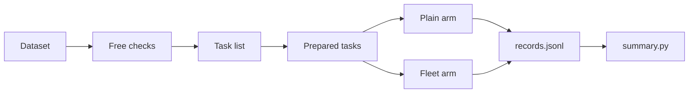

# Eval harness

This folder compares a plain Claude Code session with the same session run through `/conclave:implement`. Both arms work on real SWE-rebench tasks, each in its own container, driven by the Harbor runner (`harbor==0.26.0`). The output is a report with resolve rates, cost, time and tokens per arm. It is not a pass or fail verdict.

## Why

The fleet plans, dispatches subagents and verifies, so it spends more per task than a plain session. The eval measures whether it resolves more tasks, and at what cost and time.

Both arms get the same tasks, the same model, the same Claude Code version (`run_arm.sh` pins `2.1.327`) and the same task container. Only the agent setup differs.

## How it works



### The two arms

| Arm | Agent class | What it adds |
|---|---|---|
| `plain` | `conclave_agent:GuardedClaudeCode` | The runner's Claude Code agent, plus a host-only copy of the agent log folder. |
| `fleet` | `conclave_agent:ConclaveClaudeCode` | Everything in `plain`, plus the plugin, the host channel flags, two hooks and the `/conclave:implement ` prefix. |

- Host-only copy: the agent log folder is mounted into the container and written by root there. Before the runner's post-run step reads it, `GuardedClaudeCode` copies it to a sibling folder `agent-host/` without following symlinks. Only regular files and folders are copied, at most 200 MB per file and 500 MB in total. Skipped entries are listed in `agent-host/ANOMALIES.txt`. Every later host-side read uses the copy.
- Plugin: `run_arm.sh fleet` exports `.claude-plugin`, `agents`, `skills`, `guidance`, `hooks`, `eval/hooks/approver.py` and `eval/hooks/redirect_plans.py` as committed at `HEAD` (`git archive`) into `eval/.runs/export/<short-sha>`. It refuses to run if those paths have uncommitted changes. The agent uploads the export to `/opt/conclave` in the container.
- Flags: `--input-format stream-json`, `--permission-prompt-tool stdio` and `--plugin-dir /opt/conclave`. Without the host channel, `-p` does not offer the question tool.
- Prefix: the task text is sent as `/conclave:implement <task>`. A task that is only a path or a URL is refused, because the skill would read or fetch it.
- Report program: `eval/src/report.py` (trial-folder scan, summary and records, called by `run_arm.sh`). Image checks: `eval/src/check_images.py` (called by `check_tasks.sh`).
- Both arms run with `--permission-mode=bypassPermissions` (the runner's default, checked in `test_conclave_agent.py`).

### Unattended gates

The fleet arm installs two `PreToolUse` hooks:

- `approver.py` (matcher `AskUserQuestion`): answers each question with the option marked "(recommended)", or the first option, and logs each answer to `approver.jsonl`. Any error blocks the call (exit 2).
- `redirect_plans.py` (matcher `Write|Edit|Read`): Claude Code refuses writes under any `.claude` folder in unattended runs, so a call on `~/.claude/plans/<name>.md` is rewritten to the per-run folder `/logs/agent/plans/<name>.md` and logged to `redirect.jsonl`. Any other call passes untouched.

Both hooks check `CONCLAVE_EVAL=1`. Without it, `approver.py` prints an error and exits 2, which blocks the call, and `redirect_plans.py` does nothing and exits 0.

### Tasks

- Dataset: `swe-rebench/swe-rebench-leaderboard` (860 task definitions, downloaded 2026-11-18).
- Task list: `tasklists/2026-05-v1.json`. It holds the candidates with the sha256 of each instruction, the excluded tasks with a reason, the free-check results and the final `tasks`.
- Rule, in plain words: take every task created in May 2026; drop tasks whose text fails a text screen; drop tasks whose reference fix does not grade 1 or whose do-nothing run does not grade 0, both with the restricted network; drop tasks whose image fails the structural leak check; drop tasks whose repository holds agent-instruction or agent-config files.

### Network

`prepare_tasks.py` copies each listed task and adds a network policy to its `task.toml`:

- agent phase: `network_mode = "allowlist"`, `allowed_hosts = ["api.anthropic.com"]`;
- verifier phase: `network_mode = "no-network"`, so grading runs offline.

The tasks folder passed to `run_arm.sh` therefore selects the agent-phase network.

### Records

After each job, `run_arm.sh` writes one record per trial to `eval/.runs/jobs/<job>/records.jsonl`. It does so only when the token search is clean and the anomaly scan found nothing. A record holds only numbers, booleans, null, and strings from fixed lists or strict patterns (task and trial names, model, exception type, CLI version, fleet commit). It holds no free text from the container. A record that contains 12 characters in a row of the token, forwards or reversed, stops the write.

### Summary

`summary.py` reads the job folders and validates every record again with the writer's rules. Invalid records, and tasks with more than one record in a job, are dropped and counted.

- Job folders must be named `cmp1-<plain|fleet>-r<1-9>`.
- Only complete rounds are compared: a round counts when both arms have one valid record for every listed task.
- Fleet trials whose question calls differ from their approver lines are approver errors, left out of the resolve rates.
- Mean per-task difference (fleet minus plain) with an interval from 10000 bootstrap resamples of tasks, seed 20261120, 2.5th and 97.5th percentiles.
- Agent times above 3000 seconds (the tasks' agent limit) are wall-clock artefacts and set aside from the time figures.
- Spend counts a trial without a cost, or a missing record, at its arm's cap plus 1.00. The caps are fixed in the file: plain 1.00, fleet 2.50.
- Output: `records.jsonl`, `meta.json` and `summary.md` in the out-dir.

### Files

| File | Purpose |
|---|---|
| `eval/scripts/run_arm.sh` | Runs one arm, then the token search, anomaly scan, summary and records. |
| `eval/scripts/check_tasks.sh` | Free checks on task copies: reference fix, do-nothing run, leak check, agent files. No token, no model. |
| `eval/scripts/smoke.sh` | One unattended `/conclave:implement` run on a throwaway repository, on the host. Spends money. |
| `eval/scripts/leak_check.sh` | Looks for the reference fix hidden inside a task image. |
| `eval/src/conclave_agent.py` | The two agent classes for the runner. |
| `eval/src/report.py` | Checks, summarises and records one job folder; called by `run_arm.sh`. |
| `eval/src/summary.py` | Compares the arms from their records. |
| `eval/src/prepare_tasks.py` | Builds task copies with the restricted network from a task list. |
| `eval/src/fixed_lists.py` | Fixed validation lists and patterns shared by `report.py` and `summary.py`. |
| `eval/src/check_images.py` | Checks each task image: oracle and nop rewards, leak verdict, agent files; called by `check_tasks.sh`. |
| `eval/hooks/approver.py` | Hook that answers the question tool with the recommended option. |
| `eval/hooks/redirect_plans.py` | Hook that moves plan files out of `~/.claude/plans`. |
| `eval/tests/test_approver.py` | Tests for `approver.py`. |
| `eval/tests/test_redirect_plans.py` | Tests for `redirect_plans.py`. |
| `eval/tests/test_summary.py` | Tests for `summary.py`. |
| `eval/tests/test_report.py` | Tests for `report.py`: token-file refusal, the anomaly scan, the records refusal. |
| `eval/tests/test_conclave_agent.py` | Tests for the agent classes. |
| `eval/requirements.txt` | The pinned runner version and the venv recipe. |
| `eval/tasklists/2026-05-v1.json` | The May 2026 task list. |
| `eval/results/2026-05-v1/sonnet-5-5__cli-2.1.327__fleet-6b4c4cf/meta.json` | First comparison: run metadata. |
| `eval/results/2026-05-v1/sonnet-5-5__cli-2.1.327__fleet-6b4c4cf/records.jsonl` | First comparison: validated records. |
| `eval/results/2026-05-v1/sonnet-5-5__cli-2.1.327__fleet-6b4c4cf/summary.md` | First comparison: report. |

## Safety

- The token lives in `~/.config/conclave-eval/oauth-token`. Keep the folder at mode 700 and the file at mode 600. `TOKEN_FILE` overrides the path.
- Before running, `run_arm.sh` refuses unless the token file is a regular file (not a symlink), owned by you, mode 600, with a single link, and holds exactly one line: `sk-ant-oat` followed by `A-Z a-z 0-9 _ -` only.
- The token goes only into the runner process's environment, as a prefix assignment. It is never on a command line of ours, never passed with `--ae`, `--ak` or `--env-file`, never exported and never written to a file. Inherited shell tracing is switched off first.
- `run_arm.sh` refuses when `.env.local` exists in the worktree root, because the runner loads it.
- Every `CLAUDE_*`, `ANTHROPIC_*` and `MAX_THINKING_TOKENS` variable of the caller is removed before the runner starts. `check_tasks.sh` does the same and refuses if `CLAUDE_CODE_OAUTH_TOKEN` is set.
- After each job, `run_arm.sh` searches the whole worktree for the literal token. On a hit, or when the search cannot read everything, it prints only a count and exits 3 (as it also does when records are refused for token-like text). It then scans the job folder for entries that are not regular files or folders, are setuid or setgid, are owned by another user, or cannot be read, and exits 4 on any anomaly, a failed scan, or any other records failure. Records are written only after a clean search and scan. After 3 or 4, launch nothing more.
- `bypassPermissions` is used only inside disposable task containers.

Residual risks:

- The model in the container can reach the token, since the CLI there needs it.
- The token cannot be revoked and expires about a year after creation.
- The numbers in the records come from a log the container writes. A container that falsified it could change cost and token figures.
- The token search finds the literal value only, not an encoded copy.
- A gap of a few seconds between the end of the agent's work and offline grading stays on the open network.

## How to run it

### Requirements

- Docker.
- `uv`, and Python 3.12 or newer for the venv.
- A Claude subscription.

Run every command from the worktree root.

### 1. Create the venv

```bash
uv venv eval/.venv && uv pip install --python eval/.venv/bin/python -r eval/requirements.txt
```

### 2. Create the token file

```bash
claude setup-token
```

Save the printed token in the token file, and nowhere else. `cat` reads the paste from the terminal, so the token stays out of shell history:

```bash
mkdir -p ~/.config/conclave-eval
chmod 700 ~/.config/conclave-eval
( umask 077; cat > ~/.config/conclave-eval/oauth-token )
# paste the token, press Enter, then Ctrl-D
chmod 600 ~/.config/conclave-eval/oauth-token
```

### 3. Get the dataset

The set downloads without sign-in. In export mode (the default), the runner writes `<output-dir>/<dataset-name>/<task-name>/`:

```bash
eval/.venv/bin/harbor download swe-rebench/swe-rebench-leaderboard -o eval/.runs/tasks
```

The help also accepts a pinned form, `org/name@ref`. `prepare_tasks.py` checks each instruction against the sha256 in the task list, so a task that changed since the list was made is refused.

### 4. Prepare tasks

Usage: `prepare_tasks.py <tasklist.json> <candidates|tasks> <source-dir> <out-dir>`. `<source-dir>` is the downloaded dataset folder. `<out-dir>` must not exist. Exit 1 on any refusal, with nothing left behind.

```bash
# all candidates, for the free checks
python3 -I -B eval/src/prepare_tasks.py eval/tasklists/2026-05-v1.json candidates <source-dir> eval/.runs/tasks/2026-05-v1-candidates

# the final tasks, for the paid runs
python3 -I -B eval/src/prepare_tasks.py eval/tasklists/2026-05-v1.json tasks <source-dir> eval/.runs/tasks/2026-05-v1
```

### 5. Free checks

Usage: `eval/scripts/check_tasks.sh <tasks-dir> <job-prefix>`. The tasks folder must be under `eval/.runs/tasks/` and hold only task folders. The prefix is 1 to 40 letters, digits, `_` or `-`. It runs the jobs `<prefix>-oracle` and `<prefix>-nop` and may pull the task images.

```bash
eval/scripts/check_tasks.sh eval/.runs/tasks/2026-05-v1-candidates list1
```

One line per task:

```text
RESULT <task> oracle=<0|1|none> nop=<0|1|none> leak=<CLEAN|LEAK|ERROR> agentfiles=<none|present|error>
```

A usable task shows `oracle=1 nop=0 leak=CLEAN agentfiles=none`. Exit 0 ran to the end, 2 refused before running, 4 anomaly in a job folder. If the image-check step fails, the script exits with that step's own non-zero code. The output of the runner, `leak_check.sh` and docker goes to `eval/.runs/<prefix>-check.log`.

### 6. Run one arm (paid)

Usage: `eval/scripts/run_arm.sh <plain|fleet> <job-name> <tasks-dir> [extra runner arguments]`.

| Variable | Meaning |
|---|---|
| `MODEL` | Required. The model name. |
| `BUDGET` | Required. Per-trial CLI cap in dollars, for example `2.00`. |
| `SKILL_PREFIX` | Fleet only, optional, may be empty. Default `/conclave:implement `. |
| `PROBE=1` | Adds every tool call to the printed summary. |
| `TOKEN_FILE` | Default `~/.config/conclave-eval/oauth-token`. |
| `HARBOR_BIN` | Default `eval/.venv/bin/harbor`. |

Extra arguments allowed: `-n <count>` (concurrent trials), `-i <task>` (task name or glob), `--disable-verification`. Each trial gets one attempt.

```bash
MODEL=claude-sonnet-5-5 BUDGET=1.00 eval/scripts/run_arm.sh plain cmp1-plain-r1 eval/.runs/tasks/2026-05-v1 -n 3
MODEL=claude-sonnet-5-5 BUDGET=2.50 eval/scripts/run_arm.sh fleet cmp1-fleet-r1 eval/.runs/tasks/2026-05-v1 -n 3
```

Repeat with `r2`, `r3` and so on for more rounds. `summary.py` expects the names `cmp1-<plain|fleet>-r<1-9>` and the caps 1.00 and 2.50.

Exit codes: 0 run completed, nothing found; 2 refused before running; 3 token found, search incomplete, or records refused for token-like text; 4 anomaly in a trial folder, a failed scan, or any other records failure; otherwise the runner's exit code. Records are written only after a clean search and scan. The job folder is `eval/.runs/jobs/<job-name>/`, with `records.jsonl` inside.

### 7. Summary

The out-dir must be absent or empty. Exit 0 written, 2 refused.

```bash
python3 -I -B eval/src/summary.py eval/tasklists/2026-05-v1.json <out-dir> eval/.runs/jobs/cmp1-plain-r1 eval/.runs/jobs/cmp1-fleet-r1
```

### 8. Tests

```bash
python3 -I -B eval/tests/test_approver.py
python3 -I -B eval/tests/test_redirect_plans.py
python3 -I -B eval/tests/test_summary.py
python3 -I -B eval/tests/test_report.py
PYTHONDONTWRITEBYTECODE=1 PYTHONPATH=eval/src eval/.venv/bin/python -m unittest eval/tests/test_conclave_agent.py
```

### 9. Cleanup

Delete the token file, then remove the task images:

```bash
rm ~/.config/conclave-eval/oauth-token
docker image ls --format '{{.Repository}}:{{.Tag}}' | grep '^swerebench/' | xargs docker image rm
```

### Practical notes

- Disable machine sleep during paid runs. A suspended machine inflates agent times.
- Give each paid run its own spending cap.
- `eval/scripts/smoke.sh` spends real money too.

## Results

Each comparison lands in `results/<list>/<model>__cli-<version>__fleet-<commit>/`, with `records.jsonl`, `meta.json` and `summary.md`. See [`results/`](results/).

## Limits

- Few usable tasks: 8 of the 20 candidates in the first list. Ten were dropped for agent files in the repository, two because the reference fix does not grade 1 with grading offline. A thirteenth task (`youssofal__mtplx-21`) was removed earlier by the text screen, before the 20 candidates were fixed.
- No task is newer than the model's training cutoff, so the model may have seen the fixes.
- Agent times are unreliable if the machine suspends during a run.
- Under a subscription, cost has no independent source: it comes from the run log only.
